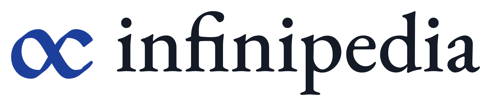

# Infinipedia logo

An infinity sign left open at its right end. Opened, it also reads as a lowercase alpha, the beginning, and as the ichthys, the fish the first Christians drew. It is written with a broad nib, thick and thin like a scribe's stroke.

| Part | Color |
| --- | --- |
| Symbol on light, and on the app tile | Lapis `#1d3f9c` |
| Symbol on dark, and the app tile | Ivory `#fbf6ea` |

The wordmark is lowercase **infinipedia** in EB Garamond Medium: ink `#141a26` on light, ivory on dark.

## Files

| File | Use |
| --- | --- |
| [infinipedia-logo-on-light.svg](infinipedia-logo-on-light.svg) · [PNG](infinipedia-logo-on-light.png) | Full logo, light backgrounds |
| [infinipedia-logo-on-dark.svg](infinipedia-logo-on-dark.svg) · [PNG](infinipedia-logo-on-dark.png) | Full logo, dark backgrounds |
| [infinipedia-mark-on-light.svg](infinipedia-mark-on-light.svg) · [PNG](infinipedia-mark-on-light.png) | Symbol only, light backgrounds |
| [infinipedia-mark-on-dark.svg](infinipedia-mark-on-dark.svg) · [PNG](infinipedia-mark-on-dark.png) | Symbol only, dark backgrounds |
| [infinipedia-app-icon.svg](infinipedia-app-icon.svg) · [PNG](infinipedia-app-icon.png) | Ivory tile with rounded corners |
| [infinipedia-app-icon-square.svg](infinipedia-app-icon-square.svg) · [PNG](infinipedia-app-icon-square.png) | Full-bleed square for platforms that apply their own mask (iOS, Android adaptive, PWA maskable). The symbol is smaller so it stays inside the maskable safe zone |
| [infinipedia-favicon.svg](infinipedia-favicon.svg) · [PNG](infinipedia-favicon.png) | Browser tab icon; the PNG is 64 px |

SVGs are filled outlines with no strokes or font dependency. Logo and symbol PNGs are transparent: logos 2400 px wide, symbols 1024 px tall. App icon PNGs are 1024 px square.

## Construction

- The centre line is an infinity sign drawn as eight cubic curves on a 100-unit grid, with 10% of its length removed around the far right point.
- The outline is that line swept along a nib 10.08 units long held at 38 degrees, then rounded by half the nib's 3.264-unit thickness.
- The wordmark is [EB Garamond](https://github.com/google/fonts/tree/main/ofl/ebgaramond) at weight 500, converted to outlines, set at 92 units with its x-height centred on the symbol and a 26-unit gap. The font and its SIL Open Font License 1.1 are in [fonts/](fonts/).
- On the app tile the symbol is scaled to 90% and the corner radius is 23 units; on the full-bleed square it is scaled to 72%.

[build.py](build.py) regenerates every file: `uv run build.py` (PNGs need `rsvg-convert`).

[options.html](options.html) is the interactive sheet this was chosen from: open it in a browser to compare the six open-infinity variants and test them at favicon, app icon and header sizes.
